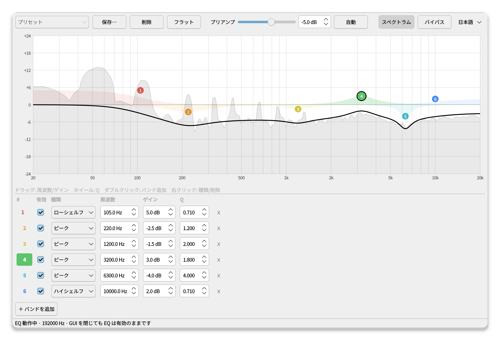
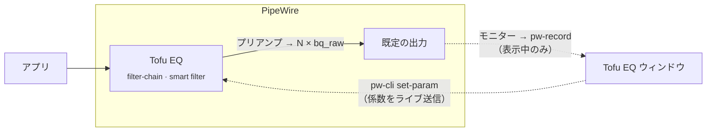

<div align="center">


# Tofu EQ

**PipeWire 向けの、とにかく軽いシステムワイド・パラメトリックイコライザー。**<br>
Linux 版の Equalizer APO のように、全アプリの音にひとつの EQ をかけてリアルタイムに調整。ウィンドウを閉じれば GUI はメモリから消えます。

[](https://github.com/AoTofu/tofu-eq/actions/workflows/ci.yml)
[](LICENSE)


[English](README.md) · **日本語** · [简体中文](README.zh-CN.md)

<br>

<picture>
  <source media="(prefers-color-scheme: dark)" srcset="docs/screenshots/main-ja-dark.png">
  
</picture>

</div>

## 特長

- **本当に軽い**: 音声処理はすべて PipeWire 内蔵の `filter-chain`（biquad フィルタ）で行います。Python の音声スレッドも余計なリサンプリングもなく、GUI を常駐させる必要もありません。バックグラウンドの EQ は約 12 MB のプロセス 1 つだけです。
- **本格パラメトリック EQ**: ピーク、ロー/ハイシェルフ、ローパス/ハイパス、バンドパス、ノッチ、オールパス。最大 32 バンドまで、周波数・ゲイン・Q を自由に設定できます。
- **音切れゼロのライブ編集**: ハンドルを動かせば即座に反映されます。フィルタの種類を切り替えても途切れません（係数をその場で差し替えるため）。
- **いつでも、どの出力にも**: 既定の出力（スピーカー、ヘッドホン、HDMI…）の手前に自動で入り、出力を切り替えても追従します。ログイン時から有効で、ウィンドウを開く必要はありません。
- **ライブスペクトラム**: 実際に聞こえている音（EQ 後）を背景に薄く表示します。取り込むのはウィンドウが見えている間だけです。
- **クリップ対策**: 合計ゲインがクリップしそうになるとカーブが赤くなり、**自動** ボタンひとつで安全なプリアンプ値に設定できます。
- **プリセット**: シンプルな JSON ファイルで保存・読込・共有できます。
- **English · 日本語 · 简体中文**: システムの言語に自動で合わせます。メニューから切り替えることもできます。

## インストール

```bash
curl -fsSL https://raw.githubusercontent.com/AoTofu/tofu-eq/main/install.sh | bash
```

これだけです。アプリメニューから **Tofu EQ** を開いてください。インストーラーは次のことを行います。

1. PipeWire 1.0 以上・WirePlumber 0.5 以上かを確認
2. PySide6 と numpy をパッケージマネージャーで導入（Fedora / Arch / Debian・Ubuntu / openSUSE）。できない場合は専用の venv を作成
3. アプリを `~/.local/share/tofu-eq` に置き、`~/.local/bin/tofu-eq` とメニュー項目を追加。ディストリのパッケージ以外に root 権限でファイルを置くことはありません

<details>
<summary><b>動作要件</b></summary>

| | 最小 | 備考 |
|---|---|---|
| PipeWire | 1.0 | `pipewire --version` で確認 |
| WirePlumber | 0.5 | 自動挿入（smart filter）に必要。0.4 の場合は出力デバイスとして **Tofu EQ** を手動で選んでください |
| Python | 3.9 | PySide6 6.5 以上と numpy |
| systemd | ユーザーセッション | バックグラウンドの EQ サービスに使用 |

Fedora 44（KDE Plasma / Wayland）で動作確認済み。デスクトップ環境は問いません（KDE、GNOME など）。

</details>

<details>
<summary><b>インストールオプション</b></summary>

```bash
# ディストリのパッケージではなく専用の Python 環境を使う
curl -fsSL https://raw.githubusercontent.com/AoTofu/tofu-eq/main/install.sh | bash -s -- --venv

# git から
git clone https://github.com/AoTofu/tofu-eq && cd tofu-eq && ./install.sh
```

</details>

## 使い方

| 操作 | 方法 |
|---|---|
| バンドを動かす（周波数・ゲイン） | 番号付きハンドルをドラッグ |
| Q（幅）を変える | ハンドルの上でホイール |
| バンドを追加 | グラフをダブルクリック、または **＋ バンドを追加** |
| 種類の変更・無効化・削除 | ハンドルを右クリック、またはバンド一覧で |
| EQ をバイパス | **バイパス** ボタン、または <kbd>Ctrl</kbd>+<kbd>B</kbd> |
| クリップを防ぐ | プリアンプ横の **自動** |

ウィンドウを閉じても EQ は止まりません。再起動後もバックグラウンドで動き続けます。

## 仕組み



- EQ 本体はユーザーサービス `tofu-eq-filter.service` が動かす PipeWire の **filter-chain** です。WirePlumber の **smart filter** 機能で既定のシンクの手前に配置されます。
- 各バンドは `bq_raw` biquad です。GUI が現在のサンプルレートで [RBJ cookbook](https://www.w3.org/TR/audio-eq-cookbook/) の係数を計算し、`pw-cli set-param` で送ります。そのため種類の変更も含め、編集で音が途切れることはありません。
- 生成される設定ファイルには主要なサンプルレート（44.1〜384 kHz）ごとの係数表も含まれるので、GUI なしでもログイン時やレート変更時に正しい特性になります。
- スペクトラムは出力デバイスのモニターを 8192 点 FFT し、1/12 オクターブ帯域で描いています。

ファイル: 設定とプリセットは `~/.config/tofu-eq/`、サービスは `~/.config/systemd/user/tofu-eq-filter.service`。

## アンインストール

```bash
~/.local/share/tofu-eq/install.sh --uninstall   # プリセットは残す
~/.local/share/tofu-eq/install.sh --purge       # すべて削除
```

## トラブルシューティング

<details>
<summary><b>EQ が効かない</b></summary>

- `systemctl --user status tofu-eq-filter` が **active** か確認してください。アプリを開くとサービスが作成・起動されます。
- `wpctl status` の *Filters* に **Tofu EQ** が出ているか確認してください。
- WirePlumber が 0.5 未満の場合は、サウンド設定で出力デバイスとして **Tofu EQ** を選んでください。
</details>

<details>
<summary><b>ブーストすると音が歪む</b></summary>

ブーストで信号が 0 dBFS を超えている可能性があります。**自動** を押すか、カーブが赤くなくなるまでプリアンプを下げてください。
</details>

<details>
<summary><b>スペクトラムボタンが押せない</b></summary>

numpy が入っていません。インストーラーを再実行するか、ディストリの `python3-numpy` を入れてください。
</details>

## 翻訳

UI の文字列は [`tofu_eq/i18n.py`](tofu_eq/i18n.py) にあります（原文は英語）。言語を追加するにはそこに表を足すだけで、`python -m unittest` を実行すれば訳し漏れを教えてくれます。言語を固定するには `TOFU_EQ_LANG=ja tofu-eq` のように起動します。

## ライセンス

[MIT](LICENSE) © AoTofu
