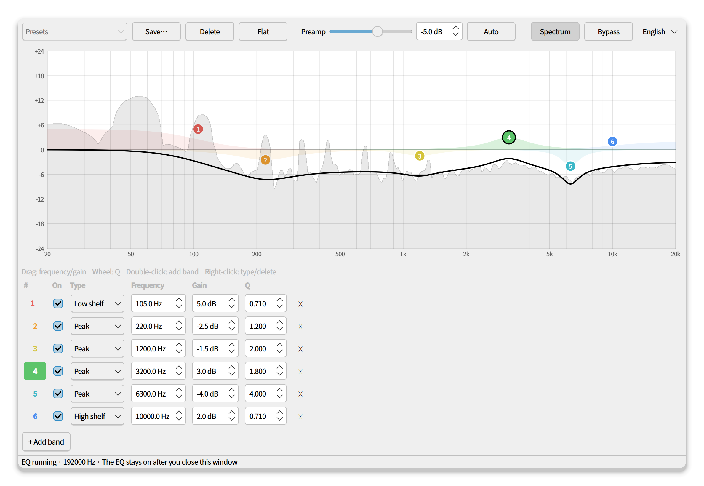
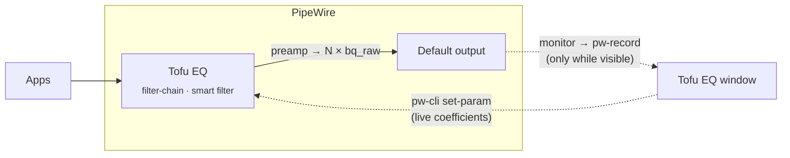

<div align="center">


# Tofu EQ

**A featherweight, system-wide parametric equalizer for PipeWire.**<br>
Like Equalizer APO, for Linux: one EQ for every app, tweaked live, with a GUI that leaves your RAM when you close the window.

[](https://github.com/AoTofu/tofu-eq/actions/workflows/ci.yml)
[](LICENSE)


**English** · [日本語](README.ja.md) · [简体中文](README.zh-CN.md)

<br>

<picture>
  <source media="(prefers-color-scheme: dark)" srcset="docs/screenshots/main-en-dark.png">
  
</picture>

</div>

## Highlights

- **Truly lightweight**: all DSP runs inside PipeWire's own `filter-chain` as plain biquads. No Python audio thread, no extra resampling, no always-on GUI. The background EQ is a ~12 MB process.
- **Real parametric EQ**: peak, low/high shelf, low/high-pass, band-pass, notch and all-pass. Up to 32 bands with freely adjustable frequency, gain and Q.
- **Zero-dropout live editing**: drag a handle and you hear it instantly. Even switching a band's filter type is glitch-free (coefficients are swapped in place).
- **Always on, everywhere**: inserts itself in front of whatever output is your default (speakers, headphones, HDMI…) and follows you when you switch. Starts at login, no window needed.
- **Live spectrum**: a subtle analyzer of what you actually hear (post-EQ), captured only while the window is visible.
- **Clip guard**: the curve turns red when the total gain could clip, and **Auto** sets a safe preamp in one click.
- **Presets**: save, load and share simple JSON files.
- **English · 日本語 · 简体中文**: follows your system language, or switch from the menu.

## Install

```bash
curl -fsSL https://raw.githubusercontent.com/AoTofu/tofu-eq/main/install.sh | bash
```

That's it. Open **Tofu EQ** from your app menu. The installer:

1. checks for PipeWire ≥ 1.0 and WirePlumber ≥ 0.5,
2. installs PySide6 + numpy with your package manager (Fedora, Arch, Debian/Ubuntu, openSUSE), or falls back to a private venv,
3. puts the app in `~/.local/share/tofu-eq`, adds a `tofu-eq` command to `~/.local/bin` and creates a menu entry. Apart from the distro packages, nothing is installed as root.

<details>
<summary><b>Requirements</b></summary>

| | Minimum | Notes |
|---|---|---|
| PipeWire | 1.0 | `pipewire --version` |
| WirePlumber | 0.5 | Needed for automatic insertion (smart filters). With 0.4, choose **Tofu EQ** as your output device manually. |
| Python | 3.9 | with PySide6 ≥ 6.5 and numpy |
| systemd | user session | runs the background EQ service |

Tested on Fedora 44 (KDE Plasma, Wayland). Any desktop works (KDE, GNOME, …).

</details>

<details>
<summary><b>Install options</b></summary>

```bash
# use a private Python environment instead of distro packages
curl -fsSL https://raw.githubusercontent.com/AoTofu/tofu-eq/main/install.sh | bash -s -- --venv

# from a git checkout
git clone https://github.com/AoTofu/tofu-eq && cd tofu-eq && ./install.sh
```

</details>

## Using it

| Action | How |
|---|---|
| Move a band (frequency / gain) | drag its numbered handle |
| Change Q (width) | scroll over the handle |
| Add a band | double-click the graph, or **+ Add band** |
| Change type · disable · delete | right-click a handle, or use the band list |
| Bypass the EQ | **Bypass** button or <kbd>Ctrl</kbd>+<kbd>B</kbd> |
| Avoid clipping | **Auto** next to the preamp |

Closing the window doesn't stop the EQ: it keeps running in the background, even after a reboot.

## How it works



- The EQ is a PipeWire **filter-chain** run by the user service `tofu-eq-filter.service`. WirePlumber's **smart filter** policy places it in front of the default sink.
- Every band is a `bq_raw` biquad. The GUI computes [RBJ cookbook](https://www.w3.org/TR/audio-eq-cookbook/) coefficients for the current sample rate and pushes them with `pw-cli set-param`. That's why edits, including type changes, never cause dropouts.
- The generated config also carries coefficient tables for every common sample rate (44.1 to 384 kHz), so the EQ stays correct at login and across sample-rate changes, even without the GUI.
- The spectrum is an 8192-point FFT of the output device's monitor, drawn as 1/12-octave bands.

Files: settings and presets in `~/.config/tofu-eq/`, the service in `~/.config/systemd/user/tofu-eq-filter.service`.

## Uninstall

```bash
~/.local/share/tofu-eq/install.sh --uninstall   # keeps your presets
~/.local/share/tofu-eq/install.sh --purge       # removes everything
```

## Troubleshooting

<details>
<summary><b>The EQ has no effect</b></summary>

- `systemctl --user status tofu-eq-filter` should be **active**. Opening the app (re)creates and starts it.
- `wpctl status` should list **Tofu EQ** under *Filters*.
- With WirePlumber < 0.5, select **Tofu EQ** as the output device in your sound settings.
</details>

<details>
<summary><b>The sound is distorted when I boost</b></summary>

Boosting can push the signal above 0 dBFS. Press **Auto** (or lower the preamp until the curve is no longer red).
</details>

<details>
<summary><b>The spectrum button is greyed out</b></summary>

numpy is missing. Re-run the installer, or install your distro's `python3-numpy`.
</details>

## Translations

UI strings live in [`tofu_eq/i18n.py`](tofu_eq/i18n.py) (English is the source text). To add a language, add a table there, and `python -m unittest discover -s tests` will tell you if any string is missing. Force a language with `TOFU_EQ_LANG=ja tofu-eq`.

## License

[MIT](LICENSE) © AoTofu
