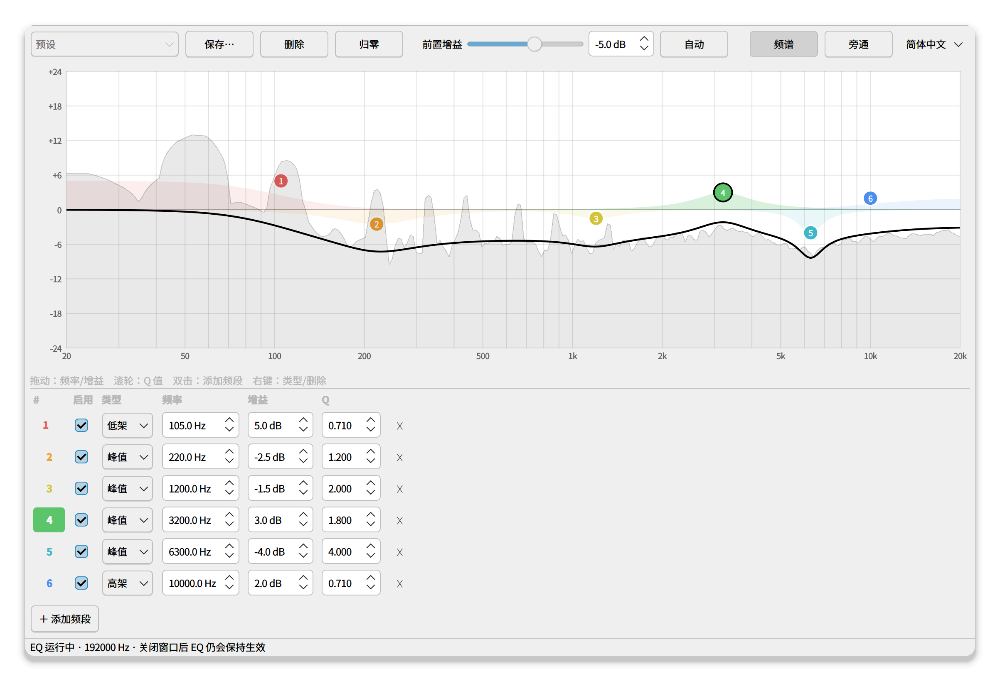
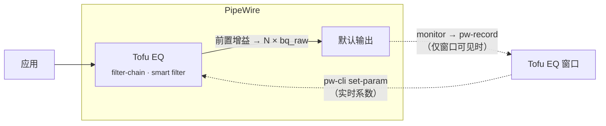

<div align="center">


# Tofu EQ

**为 PipeWire 打造的超轻量全局参数均衡器。**<br>
就像 Linux 上的 Equalizer APO：一个 EQ 作用于所有应用，实时调节；关闭窗口后 GUI 不再占用内存。

[](https://github.com/AoTofu/tofu-eq/actions/workflows/ci.yml)
[](LICENSE)


[English](README.md) · [日本語](README.ja.md) · **简体中文**

<br>

<picture>
  <source media="(prefers-color-scheme: dark)" srcset="docs/screenshots/main-zh_CN-dark.png">
  
</picture>

</div>

## 亮点

- **真正轻量**：所有 DSP 都在 PipeWire 自带的 `filter-chain` 中以普通的双二阶（biquad）滤波器运行。没有 Python 音频线程，没有额外重采样，也不需要常驻 GUI。后台 EQ 只是一个约 12 MB 的进程。
- **真正的参数均衡器**：峰值、低架/高架、低通/高通、带通、陷波和全通。最多 32 个频段，频率、增益、Q 值均可自由设置。
- **零中断实时编辑**：拖动控制点即可立即听到效果。即使切换频段的滤波器类型也不会产生爆音（系数是原地替换的）。
- **始终生效，适用于任何输出**：自动插入到当前默认输出（扬声器、耳机、HDMI 等）之前，切换输出时也会自动跟随。登录后即生效，无需打开窗口。
- **实时频谱**：在背景中淡淡地显示你实际听到的声音（EQ 处理后）的频谱，仅在窗口可见时采集。
- **防削波**：当总增益可能导致削波时曲线会变红，点击 **自动** 即可一键设置安全的前置增益。
- **预设**：以简单的 JSON 文件保存、加载和分享。
- **English · 日本語 · 简体中文**：自动跟随系统语言，也可以在菜单中切换。

## 安装

```bash
curl -fsSL https://raw.githubusercontent.com/AoTofu/tofu-eq/main/install.sh | bash
```

就这么简单。然后在应用菜单中打开 **Tofu EQ**。安装脚本会：

1. 检查 PipeWire ≥ 1.0 和 WirePlumber ≥ 0.5；
2. 通过包管理器安装 PySide6 和 numpy（Fedora、Arch、Debian/Ubuntu、openSUSE），否则自动改用独立的 venv；
3. 把应用放到 `~/.local/share/tofu-eq`，并添加 `~/.local/bin/tofu-eq` 和菜单项。除发行版软件包外，不会以 root 身份写入任何文件。

<details>
<summary><b>系统要求</b></summary>

| | 最低版本 | 说明 |
|---|---|---|
| PipeWire | 1.0 | 用 `pipewire --version` 查看 |
| WirePlumber | 0.5 | 自动插入（smart filter）需要。若为 0.4，请在声音设置中手动选择 **Tofu EQ** 作为输出设备 |
| Python | 3.9 | 需要 PySide6 ≥ 6.5 和 numpy |
| systemd | 用户会话 | 用于运行后台 EQ 服务 |

已在 Fedora 44（KDE Plasma，Wayland）上测试。适用于任何桌面环境（KDE、GNOME 等）。

</details>

<details>
<summary><b>安装选项</b></summary>

```bash
# 使用独立的 Python 环境，而不是发行版软件包
curl -fsSL https://raw.githubusercontent.com/AoTofu/tofu-eq/main/install.sh | bash -s -- --venv

# 从 git 源码安装
git clone https://github.com/AoTofu/tofu-eq && cd tofu-eq && ./install.sh
```

</details>

## 使用方法

| 操作 | 方式 |
|---|---|
| 移动频段（频率/增益） | 拖动带编号的控制点 |
| 调整 Q 值（带宽） | 在控制点上滚动鼠标滚轮 |
| 添加频段 | 双击图表，或点击 **＋ 添加频段** |
| 更改类型 · 停用 · 删除 | 右键单击控制点，或在频段列表中操作 |
| 旁通 EQ | **旁通** 按钮或 <kbd>Ctrl</kbd>+<kbd>B</kbd> |
| 避免削波 | 前置增益旁的 **自动** |

关闭窗口不会停止 EQ：它会继续在后台运行，重启后也一样。

## 工作原理



- EQ 本体是由用户服务 `tofu-eq-filter.service` 运行的 PipeWire **filter-chain**，并借助 WirePlumber 的 **smart filter** 策略放置在默认输出之前。
- 每个频段都是一个 `bq_raw` biquad。GUI 按当前采样率计算 [RBJ cookbook](https://www.w3.org/TR/audio-eq-cookbook/) 系数，并通过 `pw-cli set-param` 发送。因此任何编辑（包括切换类型）都不会造成音频中断。
- 生成的配置文件还为所有常见采样率（44.1–384 kHz）预置了系数表，所以即使不打开 GUI，登录时或采样率切换后 EQ 也能保持正确。
- 频谱由输出设备 monitor 信号的 8192 点 FFT 得出，并按 1/12 倍频程分段绘制。

文件位置：设置和预设在 `~/.config/tofu-eq/`，服务在 `~/.config/systemd/user/tofu-eq-filter.service`。

## 卸载

```bash
~/.local/share/tofu-eq/install.sh --uninstall   # 保留预设
~/.local/share/tofu-eq/install.sh --purge       # 全部删除
```

## 常见问题

<details>
<summary><b>EQ 没有效果</b></summary>

- `systemctl --user status tofu-eq-filter` 应显示 **active**。打开应用时会自动创建并启动该服务。
- `wpctl status` 的 *Filters* 中应能看到 **Tofu EQ**。
- 若 WirePlumber 低于 0.5，请在声音设置中选择 **Tofu EQ** 作为输出设备。
</details>

<details>
<summary><b>提升增益后声音失真</b></summary>

提升可能使信号超过 0 dBFS。点击 **自动**，或降低前置增益直到曲线不再变红。
</details>

<details>
<summary><b>频谱按钮是灰色的</b></summary>

缺少 numpy。重新运行安装脚本，或安装发行版的 `python3-numpy`。
</details>

## 翻译

界面文字位于 [`tofu_eq/i18n.py`](tofu_eq/i18n.py)（以英文为原文）。添加新语言只需在其中新增一张表，运行 `python -m unittest discover -s tests` 即可检查是否有遗漏。可用 `TOFU_EQ_LANG=zh_CN tofu-eq` 强制指定语言。

## 许可证

[MIT](LICENSE) © AoTofu
